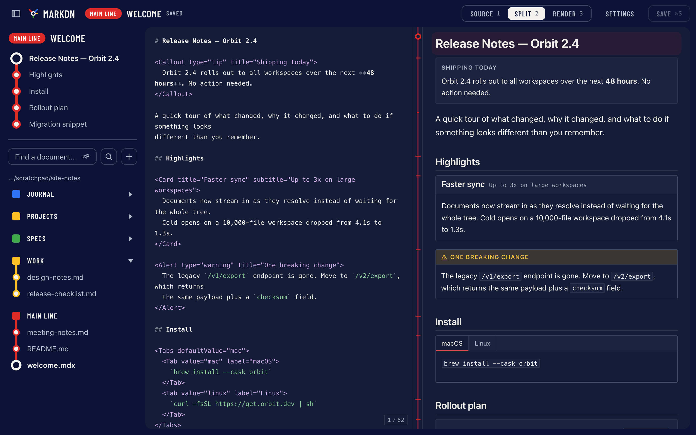
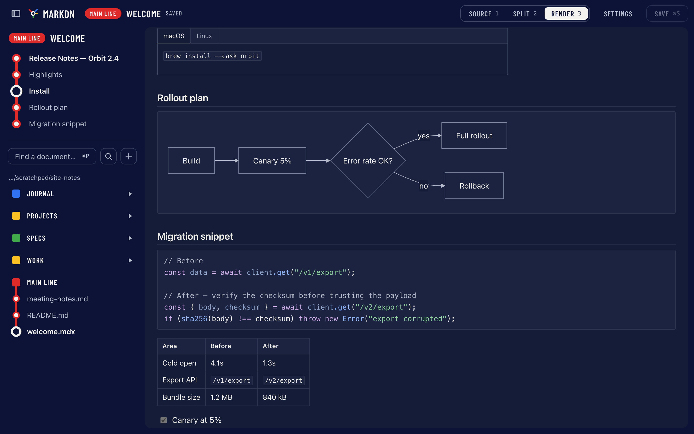
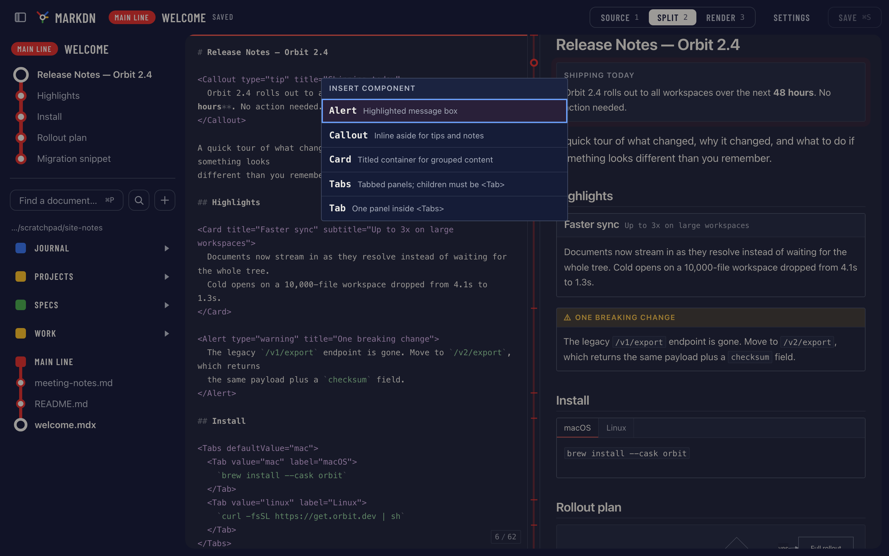

# MarkDN

**A markdown and MDX editor that renders the whole document.** Diagrams, code,
components. Your folder, your files, on your machine.



## Install

**macOS — Homebrew**

```bash
brew tap filipecabaco/markdn https://github.com/filipecabaco/markdn
brew install --cask markdn
```

**macOS and Linux — one line**

```bash
curl -fsSL https://raw.githubusercontent.com/filipecabaco/markdn/main/install.sh | sh
```

MarkDN currently ships unsigned, so the installer clears the macOS quarantine
flag for you — otherwise Gatekeeper refuses to open it.

## What you get

**Source and render, side by side and in step.** Scroll either pane and the
other follows by block, not by percentage, so a three-line diagram and its
full-size render stay together. One keystroke switches to source only or render
only.

**The parts other previewers drop.** Tables, task lists, footnotes.
Syntax-highlighted code. ` ```mermaid ` fences drawn as real diagrams. And MDX
components — `<Alert>`, `<Callout>`, `<Card>`, `<Tabs>` — appearing in the
preview as you type.



**Find any document by feel.** `Cmd/Ctrl+P` and type roughly what you remember:
`dsn` finds `work/design-notes.md` three folders down. Open it with no query and
it lists what you touched last.

**Search across every document, and edit what you find.** `Cmd/Ctrl+Shift+F`
searches the whole folder and shows each match with the lines around it — as
editable source, not as a preview. Fix a dozen files in one pass, replace across
all of them at once, and save the lot with one `Cmd/Ctrl+S`. The lines a result
does not show are still there: what gets written back is the document.

**The source pane is highlighted too.** Headings, emphasis, code fences, links
and component tags are coloured as you type, in a plain textarea — so the caret,
the selection, and undo behave exactly the way they do everywhere else on your
machine.

**Every command in the same place.** The same palette runs the app: switch view,
insert a component, change the root, start reading. Type `>` to see only
commands. Nothing hides in a menu you have to go find.



**Long documents scroll themselves.** `Cmd/Ctrl+Space` starts a teleprompter for
the rendered pane. `+` and `-` set the pace while it runs, space holds it,
escape ends it. Reach for the arrow keys mid-scroll and it steps aside, then
picks up again a moment after you stop.

**Settings, not preferences.** Root folder, theme, default view, text size,
scroll speed, hidden files. Six things that change how the app behaves, in one
panel, saved in one small file you can also edit by hand.

**Plain files, start to finish.** Nothing is imported, converted, or filed in a
database. `Cmd/Ctrl+S` writes the same `.md`, `.markdown`, or `.mdx` you opened,
in place.

**Paste into Notion as real blocks.** "Copy document for Notion" in the command
palette (or "Copy for Notion" on any file's right-click menu) puts the document
on the clipboard as rich text, so Notion builds headings, lists, tables, quotes
and code blocks from it instead of a wall of markdown. Components translate:
alerts and callouts become quotes with a bold title, cards a heading, tabs every
tab in turn, and mermaid a `mermaid` code block, which Notion draws. Apps that
only take plain text get the markdown source. Images served from your folder
can't be fetched by Notion and arrive as a line naming them.

**New, renamed, or trashed, from the tree.** `Cmd/Ctrl+N` names a new document
beside the one you are reading, creating any folders the name needs; a name
that is already taken is refused, never overwritten. Typed into an untitled
buffer first? `Cmd/Ctrl+S` asks for a name and saves what you wrote. Right-click
any file to rename it, copy its path, or move it to the Trash, where it can come
back from. The tree works from the keyboard too: arrows to walk it, `Shift+F10`
for the same menu.

**Your assistant works on the same file you do.** MarkDN speaks MCP, so Claude
and other agents can list, read, and write the documents you have open — and the
window updates the moment they do. If you have unsaved changes when they write,
MarkDN asks whether to reload theirs or keep yours instead of replacing your text.

**Private by default.** Everything runs on your machine. Nothing leaves it, and
MDX is rendered, never executed.

## Using it

The keys are VS Code's, so the ones you already know work here.

| | |
| --- | --- |
| `Cmd/Ctrl+P` | Find a document (Quick Open) |
| `Cmd/Ctrl+Shift+P` | Command palette |
| `Cmd/Ctrl+Shift+F` | Search and edit across documents |
| `Cmd/Ctrl+B` | Show or hide the sidebar |
| `Cmd/Ctrl+Shift+V` | Toggle the preview |
| `Cmd/Ctrl+K` `V` | Open the preview to the side (split) |
| `Cmd/Ctrl+1` `2` `3` | Source, split, render |
| `Cmd/Ctrl+N` | New document |
| `Cmd/Ctrl+S` | Save, or name and save an untitled document |
| `F2` | Rename the file selected in the tree |
| `Cmd+Backspace` | Move the selected file to the Trash |
| `Cmd+Alt+C` / `Cmd+Alt+Shift+C` | Copy its path / relative path |
| `Shift+F10` | Menu for the file selected in the tree |
| `Ctrl+Shift+M` | Toggle whether Tab moves focus out of the editor |
| `Cmd/Ctrl+Shift+C` | Insert a component |
| `Cmd/Ctrl+,` | Settings |
| `Cmd/Ctrl+Space` | Start, pause, resume auto-scroll |
| `↑` `↓` | Scroll by hand, any time |
| `+` `-` | Auto-scroll faster, slower |
| `Esc` | Stop auto-scroll |

## Working with an assistant

Point any MCP client at MarkDN while it is running:

```
http://localhost:43118/mcp
```

It can list, read, and write your documents, and ask which components are
available so the MDX it writes is MDX that renders. An assistant editing a file
you have open is visible immediately, in the window, where you can keep or change
it — and an edit it makes while you have unsaved changes is offered, not forced.

## Contributing

Building from source, desktop packaging, CI, and the release process are in
[docs/DEVELOPMENT.md](docs/DEVELOPMENT.md).
